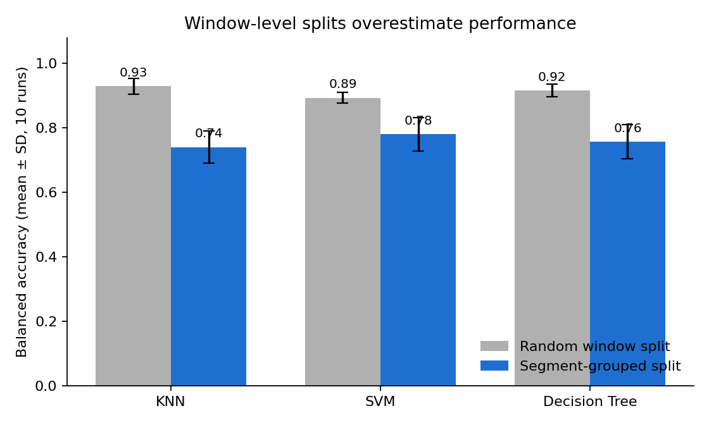
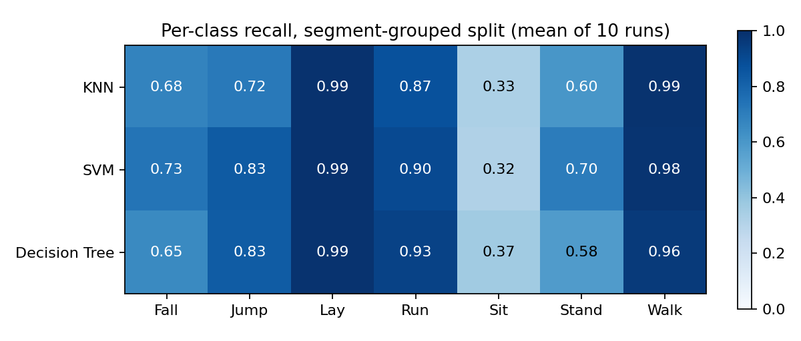
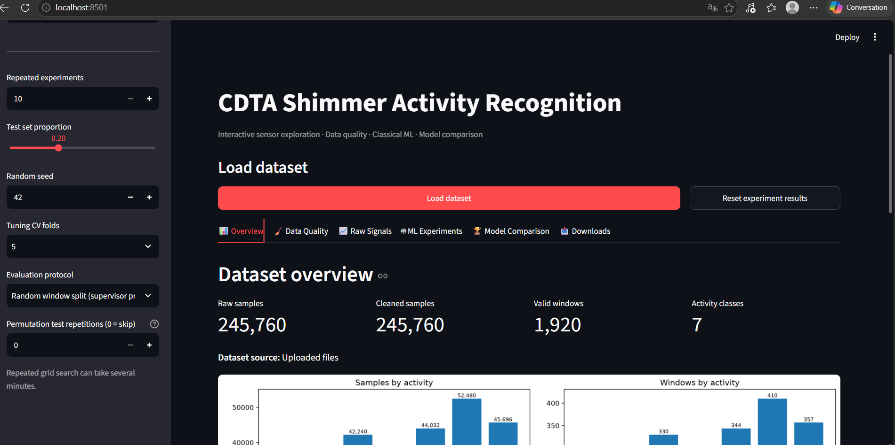
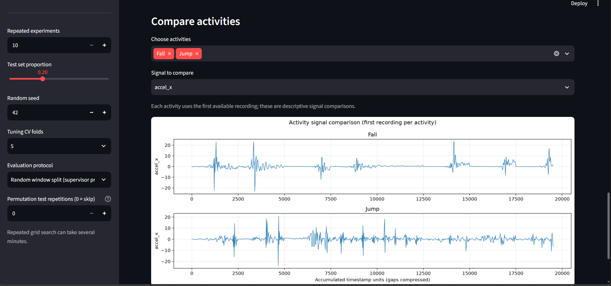
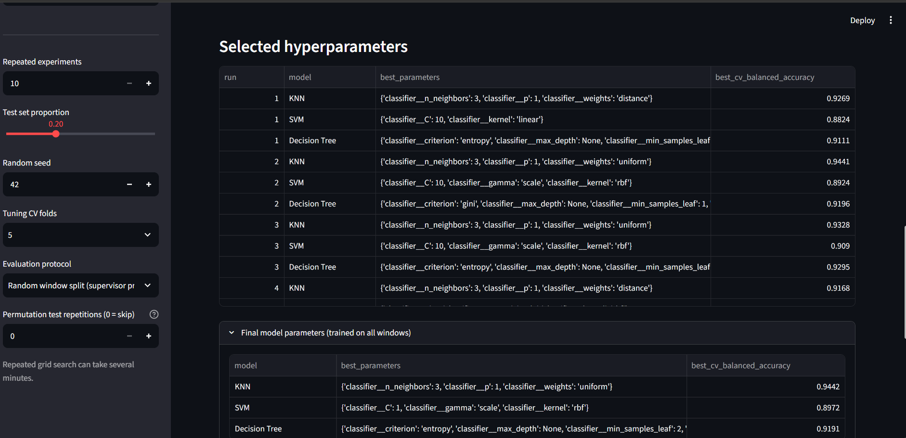
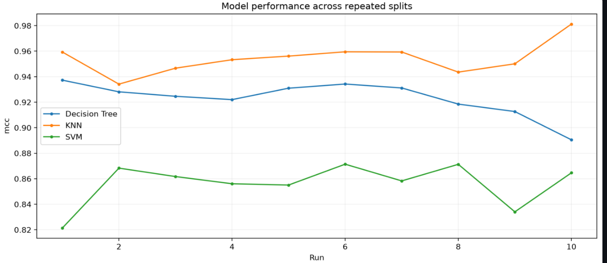
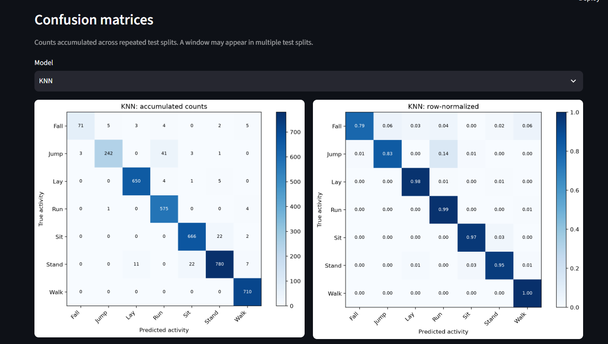
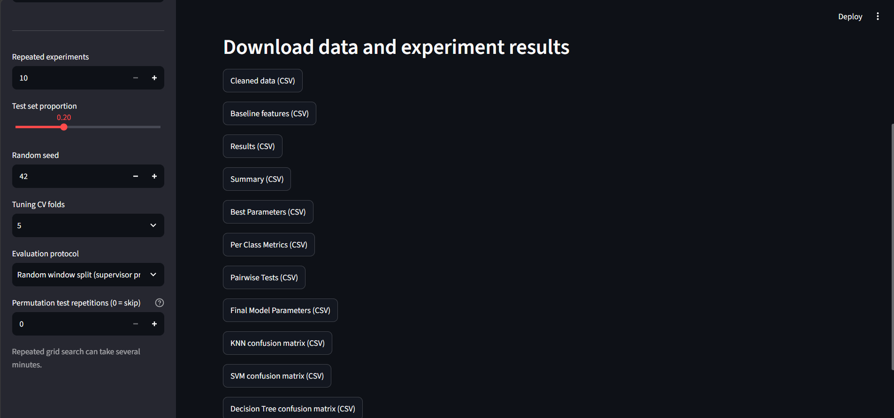

# Human Activity Recognition on Shimmer Accelerometer Data

Classical machine learning (KNN, SVM, Decision Tree) for recognising seven activities
from Shimmer accelerometer recordings, with a Streamlit dashboard, repeated-split
evaluation, statistical tests and a leakage-aware (segment-grouped) control.

Developed during the CDTA internship *ML Fundamentals & Transfer Learning*
(Centre de Développement des Technologies Avancées, October 2026).



## Key results

| Protocol | Best model | Accuracy | Balanced accuracy | MCC |
|---|---|---|---|---|
| A. Random window split (10 runs) | KNN | 0.962 | 0.930 | 0.955 |
| B. Segment-grouped split (10 runs) | SVM | 0.779 | 0.780 | 0.742 |

- All models are far above chance (permutation test, 100 permutations, p = 0.0099, the minimum possible).
- A random split of windows **overestimates** performance: neighbouring windows from the same
  recording segment end up in both train and test. Holding out whole segments lowers balanced
  accuracy by 0.11 to 0.19 and changes the model ranking.
- On unseen segments, **Sit and Stand are the weak classes** (recall about 0.33 and 0.6 to 0.7).



The full analysis is in the project report.

## Dataset

Seven MATLAB files, one per activity (`Fall`, `Jump`, `Lay`, `Run`, `Sit`, `Stand`, `Walk`), each with a
variable `data` of 11 columns: timestamp, accelerometer X/Y/Z, and seven further channels (not used).
The `.mat` files are provided by CDTA and are **not** included in this repository; put them in `data/`.

| Activity | Samples | Windows (128) | Segments |
|---|---|---|---|
| Fall | 6,016 | 47 | 13 |
| Jump | 18,304 | 143 | 12 |
| Lay | 42,240 | 330 | 12 |
| Run | 36,992 | 289 | 13 |
| Sit | 44,032 | 344 | 10 |
| Stand | 52,480 | 410 | 16 |
| Walk | 45,696 | 357 | 13 |

Notes that matter for the evaluation:

- The median timestamp step is 19.53 units, about 51.2 Hz if the unit is milliseconds, so a
  128-sample window lasts about 2.5 s (the assignment states 2.56 s at 50 Hz). The unit is unconfirmed.
- Timestamps are not monotonic. Each file is a concatenation of several recording segments; a new
  segment starts at every timestamp reset (89 segments in total).
- There are no subject or session identifiers, so segments are the only proxy for independent recordings.

## Method

1. **Windows**: non-overlapping windows of 128 samples (no leftover samples).
2. **Features** (12 per window): max, min, mean and standard deviation (`ddof=1`) of X, Y and Z.
3. **Models**: KNN, SVM (RBF or linear) and Decision Tree, each in a pipeline with standardisation
   fitted on the training data only.
4. **Tuning**: grid search with 5-fold stratified cross-validation on the training split only,
   scored by balanced accuracy. The test split is used once.
5. **Protocols** (10 runs each, seed 42 + run number):
   - **A. Random**: stratified random 75/25 split of windows (requested by the supervisor).
   - **B. Segment-grouped**: whole segments are assigned to train or test, class by class, so no
     segment appears on both sides. Tuning folds are grouped too.
6. **Metrics**: accuracy, balanced accuracy, weighted/macro F1, MCC and macro one-vs-rest ROC-AUC.
7. **Statistical tests** (`stat_tests.py`):
   - permutation test against chance level (random protocol);
   - paired Wilcoxon signed-rank and Nadeau-Bengio corrected t-test between models, Holm-adjusted;
   - Friedman test over the three models.

   The runs reuse the same windows, so they are not independent and p-values are approximate.

## Project structure

```
.
├── app.py                  # Streamlit dashboard
├── data_utils.py           # load / clean MAT and CSV files
├── feature_extraction.py   # 128-sample windows, 12 features, segment group_id
├── ml_experiments.py       # models, nested tuning, repeated evaluation (random / grouped)
├── stat_tests.py           # permutation test, paired tests, Friedman
├── model_io.py             # save / load / use the trained final models
├── eda_visualizations.py   # exploratory plots used by the dashboard
├── model_visualizations.py # model comparison plots used by the dashboard
├── requirements.txt
├── data/                   # put Fall.mat ... Walk.mat here (git-ignored)
├── models/                 # saved final models (*.joblib, git-ignored)
├── results/                # CSV outputs of the experiments reported above
└── figures/                # figures used in this README
```

## Dashboard screenshots

| | |
|---|---|
|  |  |
| Overview tab and sidebar settings | Raw Signals tab (Fall vs Jump) |
|  |  |
| ML Experiments tab: selected hyperparameters | Model Comparison tab: MCC per run |
|  |  |
| Model Comparison tab: confusion matrices | Downloads tab |

(Screenshots were taken with a test proportion of 0.20; the results above use 0.25.)

## Installation

```bash
python -m venv .venv
# Windows PowerShell: .\.venv\Scripts\Activate.ps1
# Linux / macOS:      source .venv/bin/activate
python -m pip install -r requirements.txt
```

## Usage

### Dashboard

```bash
python -m streamlit run app.py
```

Set **Dataset folder** in the sidebar to the folder holding the `.mat` files (or upload them),
then pick an **Evaluation protocol** (random or segment-grouped) and run the experiments from the
*ML Experiments* tab. Results, p-values and CSV downloads are in the *Model Comparison* and
*Downloads* tabs. The default dataset path in `app.py` is a Windows path: change `DEFAULT_PATH`
for your machine.

### From Python

```python
import pandas as pd
from ml_experiments import repeated_random_split_experiments

features = pd.read_csv("results/features_128.csv")   # 1,920 windows, 12 features + metadata

result = repeated_random_split_experiments(
    features,
    n_runs=10,                 # at least 10; 100 is possible for a research run
    split_mode="grouped",      # "random" (supervisor protocol) or "grouped"
    n_permutations=100,        # permutation test, random protocol only
)

print(result["summary"])           # mean and std of every metric per model
print(result["pairwise_tests"])    # Wilcoxon + corrected t-test (Holm)
print(result["chance_test"])       # None in grouped mode
```

To rebuild the features from the raw files:

```python
import glob
from data_utils import load_uploaded_files, clean_raw_data
from feature_extraction import extract_window_features, validate_feature_table

raw, _ = load_uploaded_files(sorted(glob.glob("data/*.mat")))
clean, report = clean_raw_data(raw)
features = validate_feature_table(extract_window_features(clean))
```

A full 10-run evaluation with grid search takes a few minutes on a laptop (about 3 minutes for the
random protocol and 1.5 minutes for the grouped one in our runs).

## Saving and using the trained models

The 10 (or more) runs are **evaluation only**: every run trains a fresh model on a different split, and
KNN, SVM and Decision Tree cannot be "trained a bit more" (calling `fit` again restarts from scratch).
The model to keep is the **final model**: the tuned hyperparameters, refitted on all windows.

- **Dashboard:** *Downloads* tab, section *Trained models*: **Save final models to this folder**
  writes the files below, or download each model as a `.joblib`.
- **Python:**

```python
import model_io

model_io.save_final_models(result, "models", n_windows=len(features))   # after an experiment

bundle = model_io.load_model("models/svm_grouped_latest.joblib")
label, probabilities = model_io.predict_window(bundle, window_xyz)       # window_xyz: (128, 3) array X, Y, Z
table, activity = model_io.predict_recording(bundle, recording_xyz)      # longer recording, majority vote
```

Each save writes `<model>_<protocol>_<date>.joblib` (never overwritten), `<model>_<protocol>_latest.joblib`,
and one line per model in `models/models_registry.csv`, so every retraining stays traceable. A file contains the
full pipeline (imputer, scaler, classifier), the class names, the 12 feature names, the tuned parameters, the
cross-run metrics and the library versions. To "train more", add the new recordings, re-extract the features,
re-run the experiments and save again: you get a new versioned model and the registry shows how the scores change.

Keep in mind: the saved model is trained on all windows, so its own accuracy on those windows means nothing.
Its expected performance is the one measured over the runs (protocol A is optimistic, protocol B is the
more realistic estimate for unseen segments). Load a model with the same scikit-learn version it was saved with.

## Reproducibility

- Seed 42; run *r* uses seed 42 + *r*.
- Per-run outputs for both protocols are in `results/` (`*_results.csv`, `*_summary.csv`,
  `*_per_class_metrics.csv`, `*_pairwise_tests.csv`, `*_best_parameters.csv`).
- The random protocol reproduces the first figures reported during the internship
  (KNN accuracy 0.962, MCC 0.955).

## Limitations

- Segments come from timestamp resets, not from verified recording or participant identifiers.
  The grouped protocol is a control, not proof of generalisation to new subjects.
- Ten runs give limited resolution for p-values; the permutation test is computed for the random
  protocol only and uses models tuned on all windows.
- Timestamp units, the meaning of the extra channels and the sampling frequency are unconfirmed.
- Fall has only 47 windows, so its recall is uncertain.

## Roadmap

- [ ] Transfer learning: acceleration magnitude to image (CWT scalogram or Gramian angular field),
      pre-trained VGG/ResNet with frozen early layers and a retrained classifier head, evaluated
      with the same protocols, metrics and tests.
- [ ] Richer features (RMS, median, skewness, kurtosis, signal magnitude, frequency-domain energy),
      mainly to separate Sit from Stand.
- [ ] 100-run version of the protocol if required for the final report.

## Author

Hadil Khelif, Master 2 Bioinformatics, USTHB. Supervisor: Dr. Oussama Kerdjidj (CDTA).
